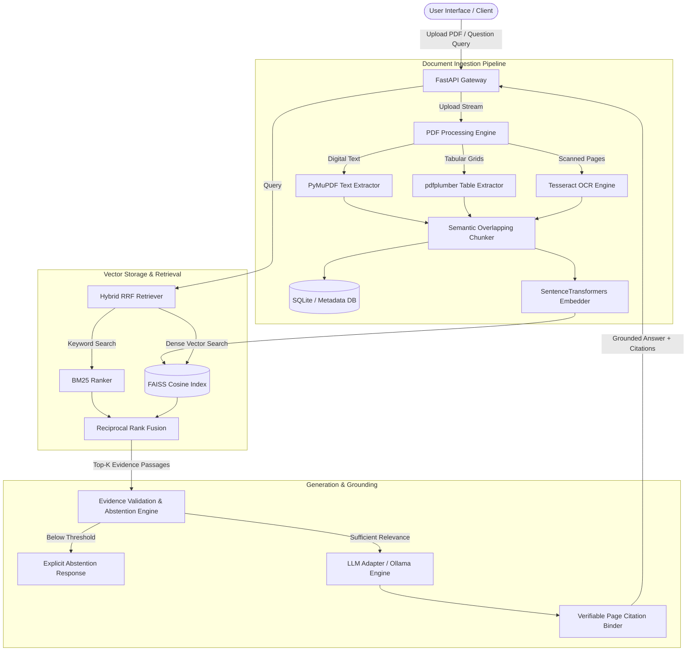

# DocuMind AI: System Architecture & Design Specification

## System Architecture Diagram

## Core Modules

### 1. Ingestion Engine (`backend/app/ingestion/`)
- **PyMuPDF (`fitz`):** Extracts digital page text and metadata.
- **pdfplumber:** Detects table grid boundaries and converts them into Markdown tables.
- **Tesseract OCR (`pytesseract`):** Detects low-text scanned pages, renders 300 DPI images, and extracts text.
- **DocumentChunker:** Creates page-aware overlapping chunks (default 600 chars, 100 char overlap) preserving `document_id`, `page_number`, `chunk_index`, `is_table`, and `is_ocr` metadata.

### 2. Retrieval Engine (`backend/app/retrieval/`)
- **FAISS IndexFlatIP:** Stores L2-normalized 384-dimensional vector embeddings generated by `all-MiniLM-L6-v2`.
- **BM25 Keyword Retriever:** Computes exact keyword matching scores over tokenized text.
- **Reciprocal Rank Fusion (RRF):** Merges vector ranks and keyword ranks using \( RRF\_Score(d) = \sum \frac{1}{k + rank(d)} \).

### 3. Generation & Grounding Engine (`backend/app/generation/`)
- **Prompt Injection Defense:** Filters input text for malicious instruction overrides.
- **Evidence Validation & Abstention:** Evaluates max relevance score against threshold \( \tau = 0.35 \). If below threshold, cleanly abstains.
- **Citation Binding:** Attaches verified `[Filename, Page X]` citations to generated answers.
